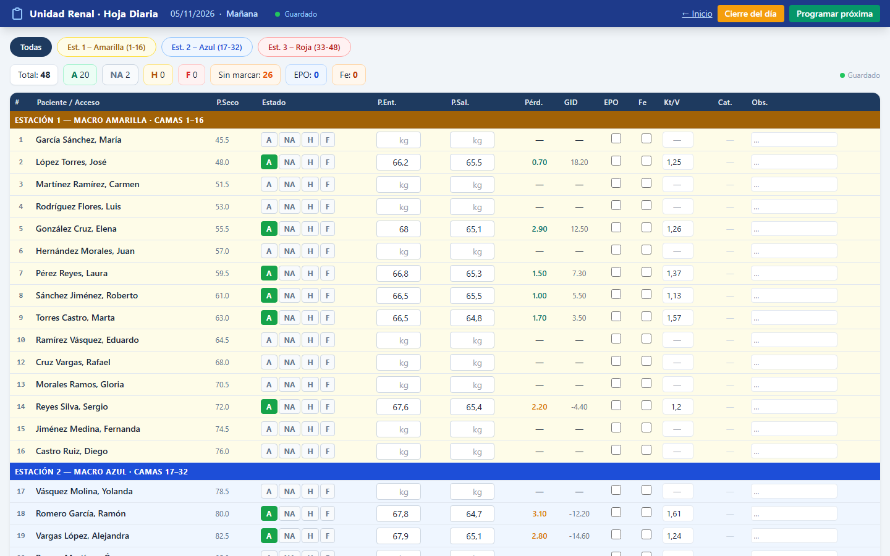
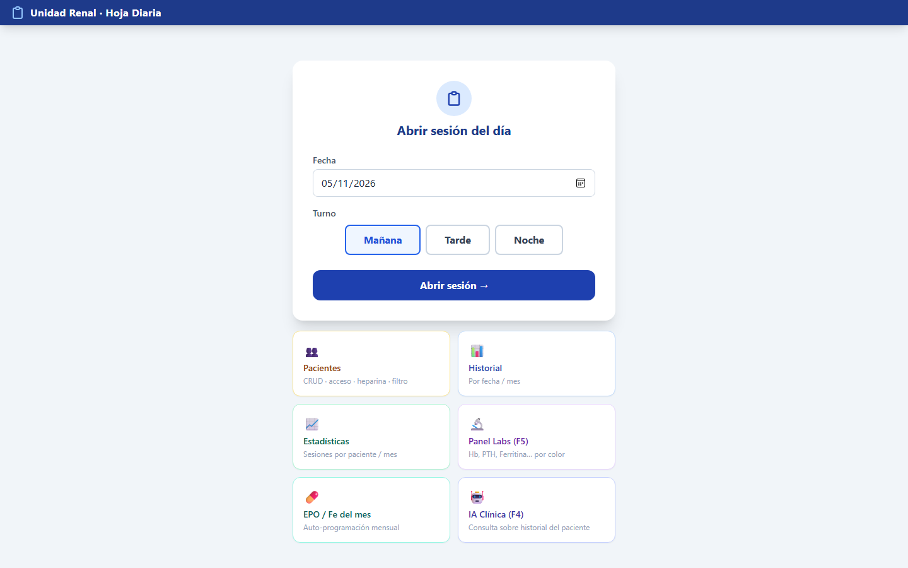
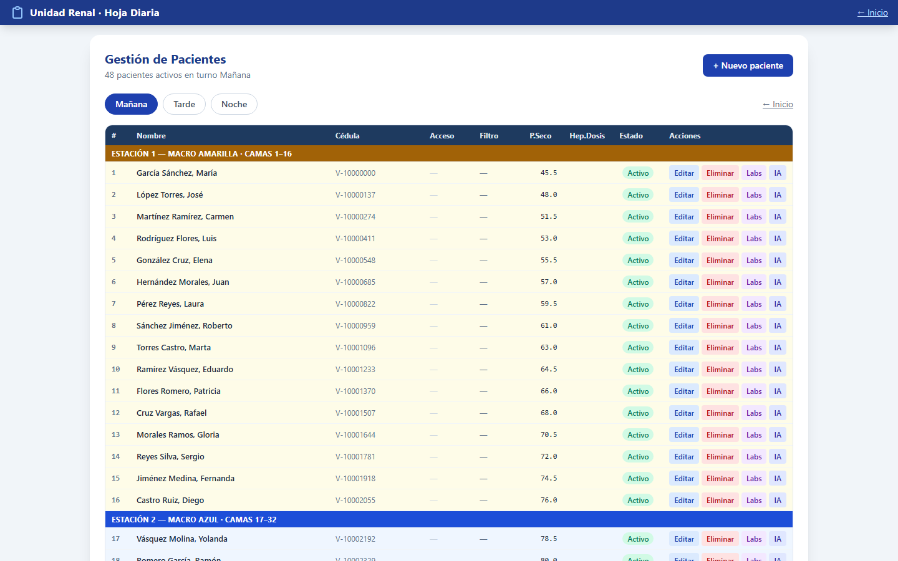
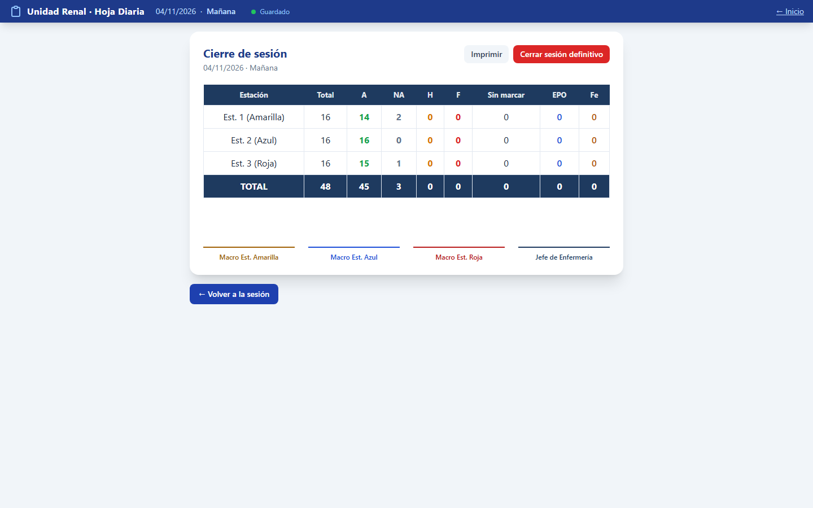
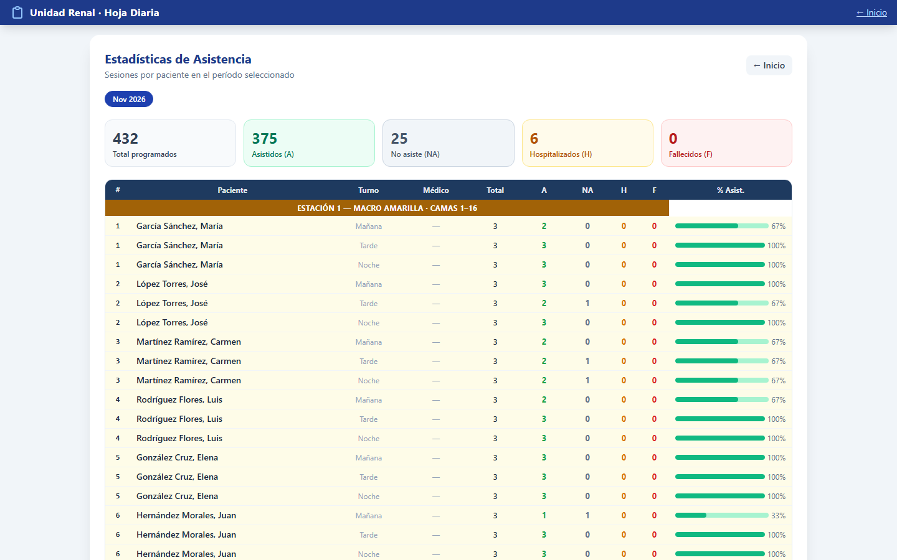

# Hoja Diaria Renal

Aplicación web para el registro diario de sesiones de **hemodiálisis** en una unidad renal. Reemplaza la hoja en papel o Excel que el equipo de enfermería llena turno a turno: asistencia, pesos de entrada y salida, Kt/V, medicación (EPO / hierro) y cierre del día por estación.



> Todos los datos de las capturas y del script de ejemplo son **ficticios**. Ningún dato real de pacientes forma parte de este repositorio.

---

## El problema

En muchas unidades renales el control diario se lleva en planillas impresas o en archivos de Excel compartidos. Eso trae varios problemas:

- **Cálculos manuales.** Pérdida de peso, ganancia interdialítica y totales se calculan a mano y se cometen errores.
- **Información dispersa.** El historial de cada paciente queda repartido entre hojas de distintos días y turnos.
- **Cierre lento.** Consolidar asistencia, ausencias y medicación al final del turno toma tiempo.
- **Sin trazabilidad.** No es fácil ver tendencias de asistencia, laboratorios o dosis de EPO y hierro mes a mes.

**Hoja Diaria Renal** digitaliza ese flujo con una interfaz que se parece a la hoja de siempre, para que el personal no tenga que aprender una forma nueva de trabajar.

## Características

- **Sesión diaria por turno** (mañana, tarde y noche), organizada en 3 estaciones de 16 camas cada una (48 puestos).
- **Registro rápido:** asistencia (A / NA / H / F), peso de entrada y salida, Kt/V, EPO, hierro, citrato, heparina sódica y observaciones, con **guardado automático**.
- **Cálculos automáticos:** pérdida real y ganancia interdialítica respecto al peso seco, con colores de alerta.
- **Reemplazos y transitorios:** asignar un paciente suplente a una cama libre y reordenar con arrastrar y soltar.
- **Cierre del día:** resumen por estación listo para imprimir con firmas, y bloqueo de la sesión una vez cerrada.
- **Programación de EPO y hierro:** programación de la siguiente sesión y autoprogramación mensual según la dosis de cada paciente.
- **Gestión de pacientes (CRUD):** acceso vascular, filtro, heparina, volumen de Watson, médico tratante y días de diálisis.
- **Laboratorios:** registro por paciente (Hb, PTH, ferritina, creatinina…) con gráficas de evolución (Chart.js) y panel con semáforo de colores por rango.
- **Historial y estadísticas** de asistencia por paciente y por mes.
- **Consulta clínica con IA (opcional):** preguntas en lenguaje natural sobre el historial de un paciente usando la API de Claude (Anthropic). Es una herramienta de apoyo informativo: no diagnostica ni prescribe.
- **Funciona sin internet:** Tailwind y Chart.js se sirven localmente desde `static/vendor/`.

## Capturas

| Inicio | Gestión de pacientes |
|---|---|
|  |  |

| Cierre del día | Estadísticas |
|---|---|
|  |  |

## Stack

| Capa | Tecnología |
|---|---|
| Backend | **Python 3.10+**, **FastAPI**, Uvicorn |
| ORM / Validación | **SQLAlchemy 2.0**, **Pydantic v2** |
| Base de datos | **SQLite** |
| Frontend | HTML + **JavaScript** puro (SPA sin framework), **Tailwind CSS** |
| Gráficas | **Chart.js** |
| IA (opcional) | **Anthropic Claude API** |

## Estructura del proyecto

```
renal-diaria/
├── main.py            # App FastAPI, registro de routers y SPA fallback
├── database.py        # Conexión SQLite / sesión SQLAlchemy
├── models.py          # Modelos: Paciente, Sesion, Registro, Programacion, Laboratorio
├── schemas.py         # Esquemas Pydantic
├── seed.py            # Genera 144 pacientes FICTICIOS de ejemplo
├── migrate.py         # Migraciones de columnas para bases existentes
├── test_api.py        # Prueba rápida de la API
├── routers/           # Endpoints: pacientes, sesiones, cierre, programación,
│                      #   laboratorios, historial, estadísticas, ia
├── static/            # Frontend (index.html, js/, css/, vendor/)
├── docs/capturas/     # Capturas para este README
├── .env.example       # Variables de entorno de ejemplo
└── Abrir-App.bat      # Lanzador para Windows
```

## Cómo correrlo en local

### 1. Requisitos

- Python 3.10 o superior
- Git

### 2. Clonar el repositorio

```bash
git clone https://github.com/devcarmona18/hoja-diaria-renal.git
cd hoja-diaria-renal
```

### 3. Crear y activar un entorno virtual

```bash
python -m venv .venv

# Windows (PowerShell)
.venv\Scripts\Activate.ps1

# macOS / Linux
source .venv/bin/activate
```

### 4. Instalar dependencias

```bash
pip install -r requirements.txt
```

### 5. Configurar variables de entorno (opcional)

Solo hace falta para el módulo de IA:

```bash
# Windows
copy .env.example .env
# macOS / Linux
cp .env.example .env
```

Luego edita `.env` y coloca tu `ANTHROPIC_API_KEY`. Sin clave, el resto de la aplicación funciona normalmente.

### 6. Cargar datos de ejemplo

```bash
python seed.py
```

Crea `renal.db` con **144 pacientes ficticios** (3 turnos × 3 estaciones × 16 camas). La base de datos se genera en local y **nunca** se sube al repositorio.

### 7. Levantar el servidor

```bash
uvicorn main:app --reload --port 8000
```

Abre **http://localhost:8000** en el navegador.
La documentación interactiva de la API está en **http://localhost:8000/docs**.

> En Windows también puedes hacer doble clic en `Abrir-App.bat`.

### 8. (Opcional) Probar la API

Con la base recién creada por `seed.py`:

```bash
python test_api.py
```

## Privacidad y datos

- El archivo `.gitignore` excluye bases de datos (`*.db`, `*.sqlite`), archivos `.env`, `ia_config.json`, logs y respaldos.
- Los nombres y cédulas generados por `seed.py` son combinaciones inventadas y no corresponden a personas reales.
- Para un uso real, la aplicación debe instalarse en la red interna de la institución y cumplir la normativa local de protección de datos de salud.

## Autor

**David Carmona**
GitHub: [@devcarmona18](https://github.com/devcarmona18)
