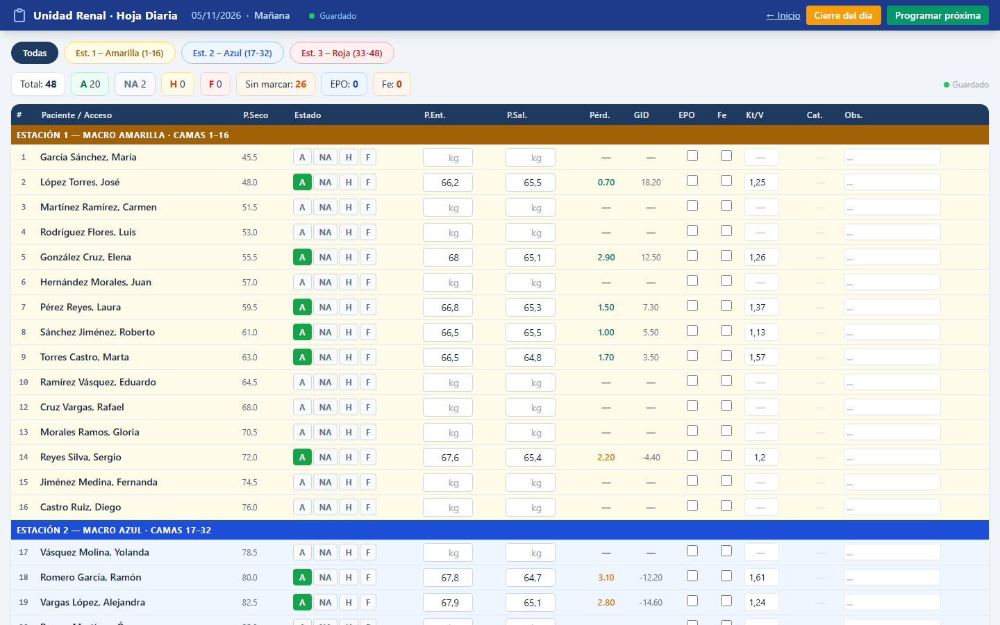
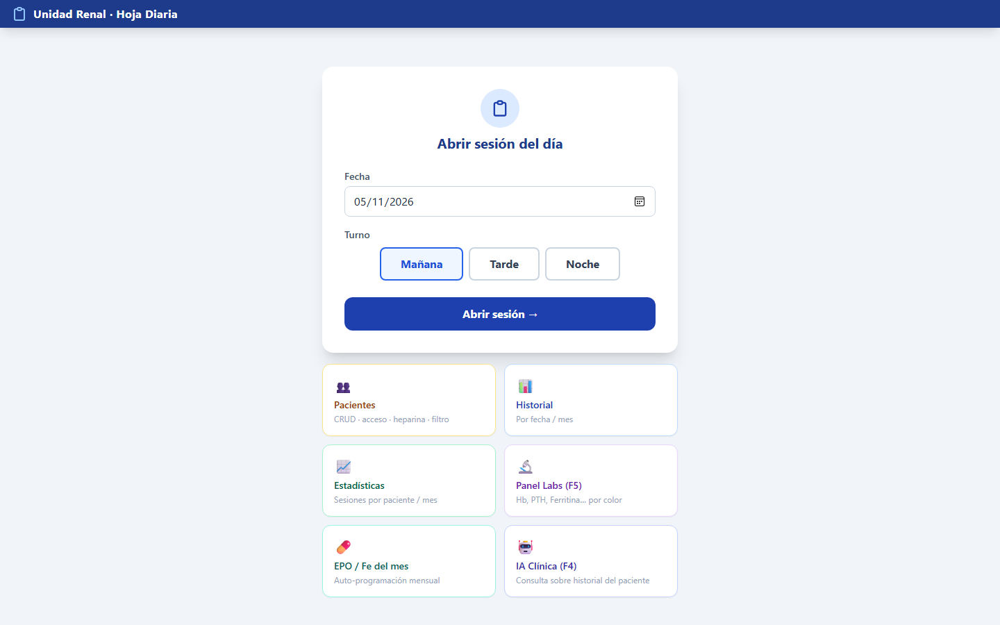
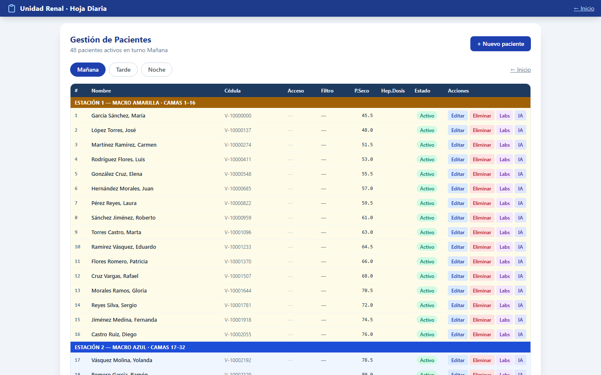
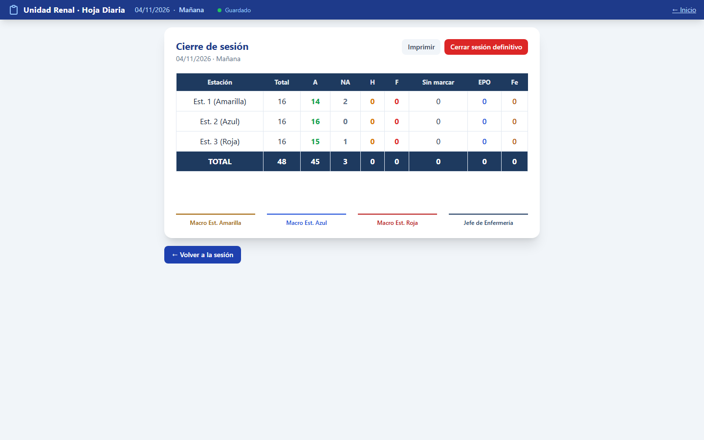
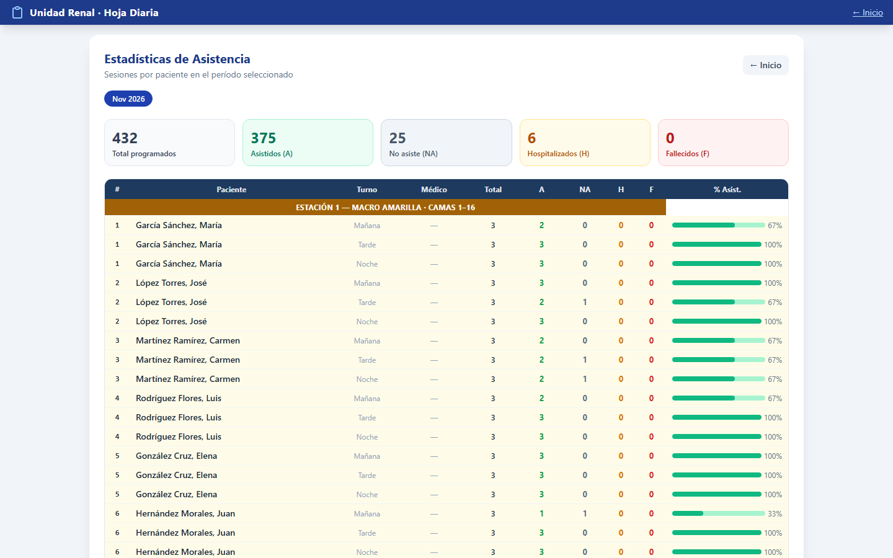

# Hoja Diaria Renal

[](https://github.com/devcarmona18/hoja-diaria-renal/actions/workflows/ci.yml)


### 🔗 Demo en vivo: **https://hoja-diaria-renal.onrender.com**

En la pantalla de ingreso pulsa **«Ver demo (solo lectura)»**: no necesitas usuario ni contraseña.

> La demo corre en el plan gratuito de Render: si nadie la ha abierto en los últimos 15 minutos, la primera carga puede tardar unos 50 segundos mientras el servidor despierta.
> Todos los pacientes de la demo y de las capturas son **ficticios**.

Aplicación web para el registro diario de sesiones de **hemodiálisis** en una unidad renal. Reemplaza la hoja en papel o Excel que el equipo de enfermería llena turno a turno: asistencia, pesos de entrada y salida, Kt/V, medicación (EPO / hierro) y cierre del día por estación.



---

## El problema

En muchas unidades renales el control diario se lleva en planillas impresas o en archivos de Excel compartidos. Eso trae varios problemas:

- **Cálculos manuales.** Pérdida de peso, ganancia interdialítica y totales se calculan a mano y se cometen errores.
- **Información dispersa.** El historial de cada paciente queda repartido entre hojas de distintos días y turnos.
- **Cierre lento.** Consolidar asistencia, ausencias y medicación al final del turno toma tiempo.
- **Sin trazabilidad.** No es fácil ver tendencias de asistencia, laboratorios o dosis de EPO y hierro mes a mes.

**Hoja Diaria Renal** digitaliza ese flujo con una interfaz que se parece a la hoja de siempre, para que el personal no tenga que aprender una forma nueva de trabajar.

## Características

- **Sesión diaria por turno** (mañana, tarde y noche), organizada en 3 estaciones de 16 camas cada una (48 puestos).
- **Registro rápido:** asistencia (A / NA / H / F), peso de entrada y salida, Kt/V, EPO, hierro, citrato, heparina sódica y observaciones, con **guardado automático**.
- **Cálculos automáticos:** pérdida real y ganancia interdialítica respecto al peso seco, con colores de alerta.
- **Reemplazos y transitorios:** asignar un paciente suplente a una cama libre y reordenar con arrastrar y soltar.
- **Cierre del día:** resumen por estación listo para imprimir con firmas, y bloqueo de la sesión una vez cerrada.
- **Programación de EPO y hierro:** programación de la siguiente sesión y autoprogramación mensual según la dosis de cada paciente.
- **Programar el día siguiente:** la misma hoja de estaciones y camas (arrastrar y soltar, reemplazos, transitorios y buscador). Los cambios aplican **solo a ese día**; «Cambio permanente» actualiza la cama habitual sin alterar las hojas pasadas.
- **Pedido de insumos:** se hace un día antes para las sesiones del próximo día de diálisis (solo pacientes activos), con reglas por acceso vascular editables (FAV, CY, citrato / heparina sódica), secciones de adicionales, devoluciones y casos a revisar, totales por insumo, impresión A4, CSV y foto inmutable al confirmar. Detalles en [`docs/insumos.md`](docs/insumos.md).
- **Gestión de pacientes (CRUD):** acceso vascular, filtro, heparina, volumen de Watson, médico tratante y días de diálisis.
- **Laboratorios:** registro por paciente (Hb, PTH, ferritina, creatinina…) con gráficas de evolución (Chart.js) y panel con semáforo de colores por rango.
- **Historial y estadísticas** de asistencia por paciente y por mes.
- **Acceso con login:** usuario administrador (lectura y escritura) y acceso **demo de solo lectura** para visitantes.
- **IA · NefroIA (opcional):** el asistente de IA para enfermería renal [NefroIA](https://github.com/devcarmona18/nefroia) integrado en el apartado «IA», con inicio de sesión único (token firmado de un solo uso, vida ≤ 2 min) y alternativa «Abrir en pestaña nueva». Hoja Diaria **no envía datos de pacientes**: solo la identidad del usuario. Sin `NEFROIA_URL` y `NEFROIA_SSO_SECRET` el apartado muestra «NefroIA no está configurado todavía». Detalles en [`docs/integracion-nefroia.md`](docs/integracion-nefroia.md).

## Próximamente: integración HL7

Conexión de **solo lectura** con las máquinas de hemodiálisis **AK 98** de la unidad: al terminar cada sesión la máquina envía (HL7 v2 ORU^R01 por MLLP) peso de entrada y salida, UF, Kt/V, tensión, frecuencia, duración y alarmas; un puente local los reenvía firmados por HTTPS y la hoja se llena como **borrador** que enfermería solo revisa y confirma.

El código ya está en el repositorio, pero está **apagado** (`HL7_ENABLED=false`): el personal solo ve la burbuja «Próximamente». Requiere autorización de la unidad, la especificación de interfaz del fabricante y la activación técnica de las máquinas. Detalles, seguridad y prueba de punta a punta con el simulador en [`docs/integracion-hl7.md`](docs/integracion-hl7.md).

## Capturas

| Inicio | Gestión de pacientes |
|---|---|
|  |  |

| Cierre del día | Estadísticas |
|---|---|
|  |  |

## Stack

| Capa | Tecnología |
|---|---|
| Backend | **Python 3.12**, **FastAPI**, Uvicorn |
| ORM / Validación | **SQLAlchemy 2.0**, **Pydantic v2** |
| Base de datos | **SQLite** (local) · **PostgreSQL** en [Neon](https://neon.tech) (producción) |
| Frontend | HTML + **JavaScript** puro (SPA sin framework), **Tailwind CSS** |
| Gráficas | **Chart.js** |
| Infraestructura | **Docker**, **Render** (Blueprint), **GitHub Actions**, **GitHub Codespaces** |
| IA (opcional) | **Anthropic Claude API** |

## Arquitectura

```
Navegador ──HTTPS──▶ Render (Docker · FastAPI/Uvicorn) ──SSL──▶ Neon (PostgreSQL)
                          ▲
GitHub (main) ── push ────┘  auto-deploy      GitHub Actions: tests en SQLite + PostgreSQL
```

## Estructura del proyecto

```
renal-diaria/
├── main.py              # App FastAPI: middlewares, routers, /health, SPA
├── config.py            # Configuración desde variables de entorno
├── auth.py              # Login (admin) y acceso demo de solo lectura
├── database.py          # Motor SQLAlchemy (SQLite o PostgreSQL)
├── models.py            # Paciente, Sesion, Registro, Programacion, Laboratorio
├── schemas.py           # Esquemas Pydantic
├── seed.py              # 144 pacientes FICTICIOS de ejemplo
├── routers/             # Endpoints por módulo
├── static/              # Frontend (index.html, login.html, js/, css/, vendor/)
├── tests/               # Pruebas con pytest
├── Dockerfile           # Imagen de producción
├── render.yaml          # Blueprint de Render
├── .devcontainer/       # Entorno para GitHub Codespaces
├── .github/workflows/   # CI
└── .env.example         # Variables de entorno de ejemplo
```

## Cómo correrlo en local

**Requisitos:** Python 3.10 o superior y Git.

```bash
# 1. Clonar
git clone https://github.com/devcarmona18/hoja-diaria-renal.git
cd hoja-diaria-renal

# 2. Entorno virtual
python -m venv .venv
.venv\Scripts\Activate.ps1        # Windows (PowerShell)
source .venv/bin/activate         # macOS / Linux

# 3. Dependencias (incluye las de pruebas)
pip install -r requirements-dev.txt

# 4. Datos de ejemplo (crea renal.db con 144 pacientes ficticios)
python seed.py

# 5. Servidor
uvicorn main:app --reload --port 8000
```

Abre **http://localhost:8000**. La documentación de la API está en **/docs**.

Sin archivo `.env` la app usa SQLite y **no pide login** (cómodo para desarrollar). Para probar el login, la demo o NefroIA, copia `.env.example` como `.env` y completa los valores:

| Variable | Para qué sirve | Por defecto |
|---|---|---|
| `DATABASE_URL` | Conexión a la BD. Acepta `postgres://`, `postgresql://` o `sqlite:///` | `sqlite:///./renal.db` |
| `DEMO_MODE` | `true`: carga los pacientes ficticios si la BD está vacía, muestra el banner y el botón «Ver demo» | `false` |
| `APP_USER` / `APP_PASSWORD` | Credenciales del administrador. Vacías = login desactivado | — |
| `SECRET_KEY` | Firma de la cookie de sesión | valor de desarrollo |
| `COOKIE_SECURE` | `true` en producción (HTTPS) | `false` |
| `NEFROIA_URL` | URL pública de NefroIA (p. ej. `https://nefroia.onrender.com`). Vacía = apartado «IA» apagado | — |
| `NEFROIA_SSO_SECRET` | Secreto compartido con NefroIA para firmar el token de acceso (≥ 32 caracteres, el mismo valor en ambos servicios) | — |
| `ARCHIVO_DIAS` | Días que un paciente archivado aparece en «Archivados» y es restaurable (nada clínico se borra); pasado el plazo se puede reactivar por cédula | `180` (6 meses) |
| `TEAMS_ENABLED` | Notificaciones de laboratorio a Teams (webhook por médico). `false` = ninguna llamada saliente | `false` |
| `TEAMS_DIAS` / `TEAMS_JOB_TOKEN` | Días del mes de envío · token del trabajo programado de GitHub Actions | `1,15` / — |

### Pruebas

```bash
python -m pytest -v
```

Con Docker: `docker build -t hoja-diaria-renal . && docker run -p 8000:8000 -e DEMO_MODE=true hoja-diaria-renal`

## Cómo desplegar

El despliegue está descrito como código en [`render.yaml`](render.yaml).

1. **Base de datos:** crea un proyecto gratuito en [Neon](https://neon.tech) y copia la *connection string* (`postgresql://…?sslmode=require`).
2. **Render:** en [dashboard.render.com](https://dashboard.render.com) elige **New → Blueprint**, conecta este repositorio y Render leerá `render.yaml`.
3. **Variables:** Render pedirá los valores marcados como secretos: `DATABASE_URL` (de Neon), `APP_USER`, `APP_PASSWORD` y, opcionalmente, `NEFROIA_URL` y `NEFROIA_SSO_SECRET` (apartado «IA», ver [`docs/integracion-nefroia.md`](docs/integracion-nefroia.md)). `SECRET_KEY` se genera solo.
4. Render construye la imagen Docker, arranca con `uvicorn main:app --host 0.0.0.0 --port $PORT` y comprueba `/health`. En el primer arranque, `DEMO_MODE=true` carga los pacientes ficticios.

A partir de ahí, **cada push a `main` se despliega solo**.

## Cómo hacer cambios

Se puede trabajar desde cualquier lugar, incluso desde el navegador o el celular, con **GitHub Codespaces**: en el repositorio, **Code → Codespaces → Create codespace on main**. El entorno se crea con Python 3.12, instala las dependencias, carga los datos de ejemplo y reenvía el puerto 8000. Luego basta con ejecutar `uvicorn main:app --reload --host 0.0.0.0 --port 8000`.

El flujo de trabajo es:

```
rama  →  Pull Request  →  CI en verde  →  merge a main  →  Render despliega solo
```

1. Crea una rama: `git checkout -b feat/mi-mejora`
2. Haz commits con [Conventional Commits](https://www.conventionalcommits.org/es/): `feat: …`, `fix: …`, `docs: …`
3. Sube la rama y abre un Pull Request hacia `main`.
4. GitHub Actions ejecuta los tests en SQLite y PostgreSQL y verifica que la imagen Docker arranque.
5. Con el CI en verde, haz merge: Render despliega la nueva versión en unos minutos.

## Privacidad y datos

- En producción solo existen los pacientes **ficticios** de `seed.py`; nombres y cédulas son combinaciones inventadas.
- `.gitignore` excluye bases de datos, archivos `.env`, logs y respaldos. Las claves viven únicamente como variables de entorno del servidor.
- El acceso demo es de solo lectura: el servidor rechaza cualquier escritura (HTTP 403).
- Para un uso real, la aplicación debe instalarse en la red interna de la institución y cumplir la normativa local de protección de datos de salud.

## Autor

**David Carmona**
GitHub: [@devcarmona18](https://github.com/devcarmona18)
