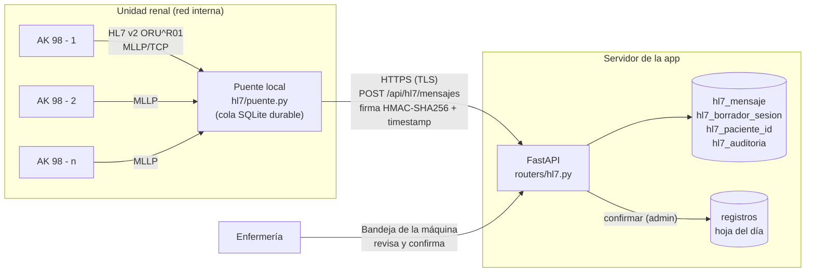

# Integración HL7 con las máquinas AK 98 — «Próximamente»

> **Estado: INACTIVA.** Todo el código está en el repositorio, pero la integración se
> activa solo con `HL7_ENABLED=true`. Mientras tanto, el personal ve únicamente la
> burbuja «Próximamente» con un video y una explicación. Ninguna otra parte de la app cambia.

## Qué resuelve

Hoy, al terminar cada sesión, enfermería transcribe a mano desde la máquina de
hemodiálisis el peso de salida, la UF, el Kt/V, la tensión, etc. Con esta
integración la máquina **envía** esos datos y la hoja diaria **se llena sola como
borrador**. El personal **solo revisa y confirma**.

Principios no negociables:

- **Solo lectura (máquina → app).** La app nunca envía prescripciones, parámetros ni
  órdenes a las máquinas. El único mensaje que sale hacia la máquina es el ACK de recepción.
- **Confirmación humana.** Nada de lo recibido es oficial hasta que una persona con rol
  administrador lo confirma. Todo queda auditado (quién, cuándo, qué se aplicó).
- **Sin datos reales en el repositorio.** El simulador y las pruebas usan datos ficticios.

## Arquitectura



| Pieza | Archivo | Qué hace |
|---|---|---|
| Parser | `hl7/parser.py` | Lee HL7 v2.x (MSH, PID, OBR, OBX), separadores de MSH-1/MSH-2, escapes, repeticiones, NM/SN/ST/TX, fechas. Sin dependencias externas. |
| Mapeo | `hl7/mapeo.py` + `hl7/mapeo_ak98.json` | Traduce cada OBX a un campo de la hoja, convierte unidades y determina fecha/turno. |
| MLLP | `hl7/mllp.py` | Marco `0x0B … 0x1C 0x0D` y ACK `AA` / `AE` / `AR`. |
| Firma | `hl7/firma.py` | HMAC-SHA256 sobre `timestamp + "." + cuerpo`. |
| Puente | `hl7/puente.py` | Servidor MLLP asyncio en un PC de la unidad; cola durable; reenvío HTTPS con reintentos. |
| Simulador | `hl7/simulador_ak98.py` | Genera mensajes de fin de sesión **ficticios** y los envía al puente. |
| API | `routers/hl7.py` | Ingesta, borradores, confirmación, descarte, vínculos y auditoría. |
| Tablas | `models_hl7.py` | Tablas nuevas `hl7_*`; no modifica las existentes. |
| Interfaz | `static/js/hl7.js`, `static/css/hl7.css` | Burbuja «Próximamente» y «Bandeja de la máquina». |

### Flujo de un mensaje

1. La AK 98 termina la sesión y envía un **ORU^R01** por MLLP al puente.
2. El puente valida que sea un ORU legible, lo guarda en su **cola SQLite** y solo
   entonces responde **ACK AA** («almacenar y reenviar»). Si está dañado responde **AE**;
   si no es un ORU, **AR**.
3. El puente lo reenvía por **HTTPS** a `POST /api/hl7/mensajes` con las cabeceras
   `X-HL7-Timestamp` y `X-HL7-Firma`. Sin red, reintenta con espera exponencial
   (5 s, 10 s, 20 s… hasta 10 min); la cola sobrevive a reinicios del PC.
4. La app verifica la firma y la ventana de tiempo, guarda el mensaje crudo
   (`hl7_mensaje`, único por **MSH-10**: reenvíos = mismo borrador), lo interpreta y crea
   un **borrador** (`hl7_borrador_sesion`) con banderas de validación.
5. En la **Bandeja de la máquina** enfermería ve los valores, las alertas y lo que ya
   hay escrito en la hoja, y pulsa **Confirmar** o **Descartar**.
6. Al confirmar, los valores se aplican al registro del paciente en la hoja de ese
   día y turno usando la **misma lógica que la edición manual** (respeta el bloqueo
   de la sesión cerrada).

### Banderas de validación del borrador

| Código | Nivel | Cuándo |
|---|---|---|
| `paciente_desconocido` | alerta | El id de la máquina no está vinculado y no coincide con ninguna cédula. |
| `vinculado_por_cedula` | info | El id de la máquina coincide con la cédula del paciente. |
| `sin_fecha_turno` | alerta | El mensaje no permite saber fecha/turno. |
| `fuera_de_rango` | alerta | Un valor sale de los rangos de `mapeo_ak98.json` (p. ej. Kt/V 0.5–3.0). |
| `salto_peso` | alerta | Peso de entrada difiere > 3.5 kg del peso de salida de la última sesión. |
| `uf_inconsistente` | alerta | Pérdida de peso y UF difieren > 0.8 kg. |
| `peso_salida_mayor` | alerta | Peso de salida > peso de entrada. |
| `sesion_cerrada` | alerta | La hoja de ese turno ya está cerrada (no se podrá confirmar). |
| `turno_distinto` | info | El turno del mensaje no es el asignado al paciente. |
| `alarmas_maquina` | info | La máquina reportó alarmas. |
| `valores_faltantes`, `obx_no_mapeados`, `advertencia` | info | Datos incompletos o desconocidos. |

### Qué se escribe en la hoja al confirmar

| Dato de la máquina | Dónde queda |
|---|---|
| Peso entrada / salida, Kt/V | Columnas `peso_entrada`, `peso_salida`, `ktv` del registro. **No sobrescribe** lo escrito a mano salvo que se pida (`sobrescribir: true`); las diferencias se informan como conflictos. |
| Asistencia | Se marca `A` solo si estaba vacía. |
| TA, FC, duración, UF, alarmas, nota | Se agregan en `observaciones` con el prefijo `AK98:` (las tablas existentes no tienen columnas para estos datos y no se modificaron). |

Si el paciente era desconocido, al confirmar se elige el paciente y se guarda el vínculo
`id de la máquina → paciente` (`hl7_paciente_id`) para los siguientes mensajes.

## Ejemplo de mensaje (ficticio)

```
MSH|^~\&|AK98|AK98-01|HOJA-DIARIA|UNIDAD-RENAL|20261117100700||ORU^R01^ORU_R01|SIM20261117M01009916|P|2.5
PID|1||AK-SIM-0001^^^AK98||FICTICIO^PACIENTE 0001
OBR|1|||HD^Sesión de hemodiálisis^AK98L|||20261117060700|20261117100700
OBX|1|NM|AK98-PESO-PRE^Peso pre^AK98L||56.6|kg|||||F|||20261117100700
OBX|2|NM|AK98-PESO-POST^Peso post^AK98L||53.1|kg|||||F|||20261117100700
OBX|3|NM|AK98-UF-TOTAL^UF total^AK98L||3740|mL|||||F|||20261117100700
OBX|4|NM|AK98-KTV^Kt/V^AK98L||1.23||||||F|||20261117100700
OBX|5|SN|AK98-PA^Tensión arterial^AK98L||^119^/^72|mm[Hg]|||||F|||20261117100700
OBX|6|NM|AK98-FC^Frecuencia cardiaca^AK98L||92|/min|||||F|||20261117100700
OBX|7|NM|AK98-DURACION^Duración^AK98L||240|min|||||F|||20261117100700
OBX|8|ST|AK98-ALARMA^Alarmas^AK98L||PRESION VENOSA ALTA~CONDUCTIVIDAD||||||F|||20261117100700
OBX|9|TX|AK98-NOTA^Nota^AK98L||Hipotensión transitoria\S\se administra SSN 100 mL||||||F|||20261117100700
```

(Los segmentos se separan con `<CR>`; aquí se muestran en líneas.) Genera más con
`python -m hl7.simulador_ak98 --solo-imprimir --maquinas 2`.

ACK que devuelve el puente:

```
MSH|^~\&|HOJA-DIARIA|UNIDAD-RENAL|AK98|AK98-01|20261117150701+0000||ACK^R01^ACK|ACK…|P|2.5
MSA|AA|SIM20261117M01009916|
```

## Mapeo (`hl7/mapeo_ak98.json`)

> ⚠️ **Los identificadores `AK98-*` son PROVISIONALES e inventados.** Deben reemplazarse
> por los que indique la **especificación de interfaz HL7 del fabricante** para el AK 98
> (o del sistema de gestión que exporte los datos de las máquinas) antes de cualquier uso real.

| OBX-3 (provisional) | Campo | Unidades aceptadas → interna |
|---|---|---|
| `AK98-PESO-PRE` | `peso_entrada` | kg, g → kg |
| `AK98-PESO-POST` | `peso_salida` | kg, g → kg |
| `AK98-UF-TOTAL` | `uf_litros` | L, mL → L |
| `AK98-KTV` | `ktv` | sin unidad |
| `AK98-PA` (SN `^130^/^80` o `130/80`) | `ta_sistolica`, `ta_diastolica` | mmHg |
| `AK98-PA-SIS` / `AK98-PA-DIA` | `ta_sistolica` / `ta_diastolica` | mmHg |
| `AK98-FC` | `frecuencia_cardiaca` | /min |
| `AK98-DURACION` | `duracion_min` | min, h, s → min (si falta: OBR-8 − OBR-7) |
| `AK98-ALARMA` (repeticiones `~`) | `alarmas` | texto |
| `AK98-NOTA` | `observaciones` | texto |

El mismo archivo define el campo del paciente (por defecto **PID-3.1**), la zona horaria
de la unidad (`-05:00`), los rangos de alerta, los umbrales y la tabla de turnos
(M 04:00–11:59, T 12:00–17:59, N 18:00–03:59; la madrugada cuenta para el turno N del día
anterior). Se puede usar otro archivo con `HL7_MAPEO_PATH`.

## Seguridad

- **HMAC-SHA256 + sello de tiempo.** Cada POST lleva `X-HL7-Timestamp` (segundos Unix) y
  `X-HL7-Firma: sha256=<hex>` calculada con `HL7_BRIDGE_SECRET` sobre
  `timestamp + "." + cuerpo`. La app rechaza (401) firmas inválidas o sellos fuera de
  ±`HL7_VENTANA_SEGUNDOS` (300 s). Comparación en tiempo constante.
- **Anti-repetición e idempotencia.** Además de la ventana de tiempo, `control_id`
  (MSH-10) es único: un mensaje repetido nunca crea un segundo borrador.
- **TLS.** El puente solo acepta `https://` (verifica el certificado; `--ca-bundle` para
  CA propias). `http://` solo se permite hacia `localhost` para pruebas.
- **Sin PHI en logs.** El puente escribe logs JSON con id de control, máquina, número de
  OBX y estados; nunca nombres, ids de paciente ni el mensaje crudo. La app no registra el
  contenido de los mensajes.
- **Datos en reposo.** La cola del puente contiene datos clínicos: se crea con permisos
  `0600` y los mensajes entregados se purgan a los 7 días (`--retencion-dias`). Usar un PC
  con disco cifrado y usuario sin privilegios.
- **Red.** El puente debe escuchar solo en la VLAN de las máquinas (`--host`) y aceptar
  solo sus IPs (`--ips-permitidas`). MLLP no tiene autenticación propia.
- **Solo lectura.** Ningún componente construye mensajes hacia las máquinas salvo el ACK.
- **Roles.** Confirmar/descartar/vincular exige rol `admin` (verificado en el endpoint
  además del middleware). El usuario demo solo puede ver.
- **Interruptor.** Con `HL7_ENABLED=false` todos los endpoints `/api/hl7/*` excepto
  `/api/hl7/estado` responden 404, no aparecen en `/docs` y la interfaz no muestra la bandeja.

## Endpoints

| Método y ruta | Acceso | Descripción |
|---|---|---|
| `GET /api/hl7/estado` | sesión iniciada | `{"habilitado": false}`. Siempre disponible (lo usa la interfaz). |
| `POST /api/hl7/mensajes` | firma HMAC (sin cookie) | Ingesta. 201 procesado · 200 duplicado · 401 firma · 422 mensaje inválido. |
| `GET /api/hl7/borradores?estado=pendiente\|confirmado\|descartado\|todos` | sesión | Lista de borradores. |
| `GET /api/hl7/borradores/{id}` | sesión | Detalle, incluye lo que ya hay en la hoja. |
| `POST /api/hl7/borradores/{id}/confirmar` | admin | Body opcional `{paciente_id, vincular, fecha, turno, sobrescribir}`. |
| `POST /api/hl7/borradores/{id}/descartar` | admin | Body `{motivo}`. |
| `GET/POST /api/hl7/vinculos`, `DELETE /api/hl7/vinculos/{id}` | admin para escribir | Id de máquina → paciente. |
| `GET /api/hl7/auditoria` | admin | Últimas acciones. |

## Probarlo de punta a punta en local (datos ficticios)

Tres terminales, desde la raíz del repositorio y con el entorno virtual activo.

**1. App con HL7 activado** (BD SQLite aparte para no mezclar con `renal.db`):

```bash
export HL7_BRIDGE_SECRET=$(python -c "import secrets; print(secrets.token_urlsafe(32))")
echo $HL7_BRIDGE_SECRET    # cópialo para la terminal 2
DATABASE_URL=sqlite:///./hl7-prueba.db DEMO_MODE=true HL7_ENABLED=true \
APP_USER=admin APP_PASSWORD=admin123 SECRET_KEY=dev \
uvicorn main:app --port 8000
```

En Windows (PowerShell) usa `$env:HL7_ENABLED="true"` etc. antes de `uvicorn`.

**2. Puente** (mismo secreto):

```bash
export HL7_BRIDGE_SECRET=<el mismo valor>
python -m hl7.puente --url http://127.0.0.1:8000/api/hl7/mensajes --puerto 2575 --cola ./puente-prueba.db
```

**3. Simulador** — usa cédulas de los pacientes ficticios del demo (`V-10000000`,
`V-10000137`, …) para que se identifiquen solos, y un id desconocido para probar el vínculo:

```bash
python -m hl7.simulador_ak98 --puerto 2575 --maquinas 4 --turno M \
  --ids V-10000000,V-10000137,V-10000274,AK-SIM-0099
python -m hl7.simulador_ak98 --puerto 2575 --maquinas 2 --prob-malformado 1   # mensajes dañados → AE
```

Luego entra a <http://localhost:8000> como `admin`, abre la burbuja verde
**Bandeja de la máquina**, revisa y confirma. Abre la sesión del día (turno Mañana) para
ver los valores en la hoja. Para probar la cola, detén la app, envía otro mensaje con el
simulador y vuelve a iniciarla: el puente lo entrega solo.

Pruebas automáticas: `python -m pytest tests/test_hl7_*.py -v`.

## Qué falta para pasar a producción

1. **Autorización** de la dirección de la unidad, del área de calidad/seguridad del
   paciente y de protección de datos (Ley 1581 de 2012 y normativa de historia clínica).
2. **Especificación de interfaz del fabricante** del AK 98 (o del software de gestión de
   las máquinas): versión HL7, si exporta ORU por MLLP, en qué momento, identificadores
   OBX reales, unidades y en qué campo viaja el id del paciente. Actualizar
   `hl7/mapeo_ak98.json` y las pruebas con mensajes de ejemplo reales **anonimizados**.
3. **Activación técnica por Ingeniería Biomédica / servicio técnico del fabricante**:
   licencia u opción de conectividad del equipo, configuración de IP/puerto destino y
   validación de que la interfaz es de solo salida.
4. **Red**: un PC fijo dentro de la unidad en la VLAN de las máquinas, IP fija, firewall
   (entrada solo desde las máquinas al puerto MLLP, salida solo HTTPS a la app), UPS, y
   el puente como servicio (systemd / Programador de tareas / NSSM en Windows).
5. **Configurar la app**: `HL7_BRIDGE_SECRET` largo y aleatorio en ambos lados,
   `HL7_ENABLED=true`, y registrar los vínculos id-máquina → paciente si no coinciden con
   la cédula.
6. **Piloto** con una máquina y doble registro (manual + automático) antes de extender.
7. **Capacitación** del personal: la bandeja es una ayuda, la confirmación es responsabilidad clínica.

## Limitaciones conocidas

- Los identificadores OBX, el campo del paciente y la disponibilidad de la interfaz HL7 en
  el AK 98 de la unidad **no están confirmados**; todo el mapeo es provisional.
- Solo se procesa **ORU^R01** (fin de sesión). No hay datos intradiálisis en tiempo real.
- TA, FC, duración, UF y alarmas se guardan como texto en `observaciones` porque las tablas
  existentes no tienen esas columnas (se decidió no modificarlas).
- La hora de la máquina define el turno; si el reloj de la máquina está mal, el borrador
  queda en otro turno (la bandeja permite indicar fecha/turno al confirmar vía API).
- Un solo secreto compartido para todos los puentes; la rotación requiere cambiarlo en
  ambos lados a la vez.
- El puente no tiene interfaz gráfica: se supervisa por sus logs JSON.
